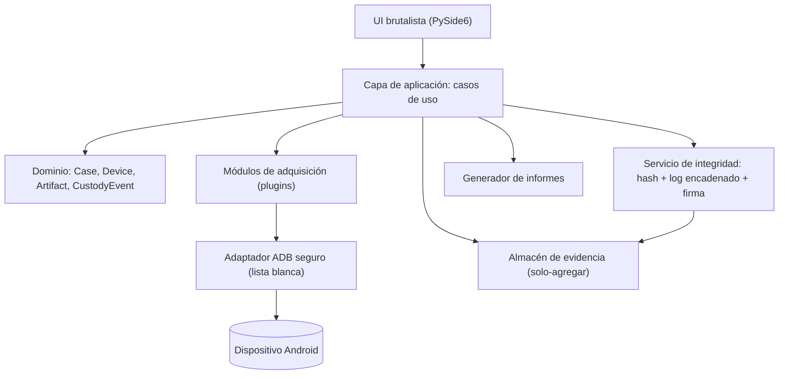
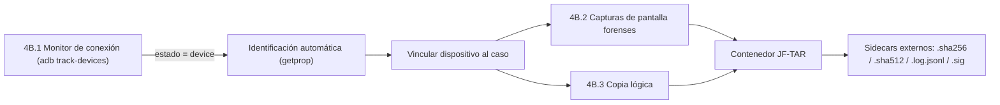
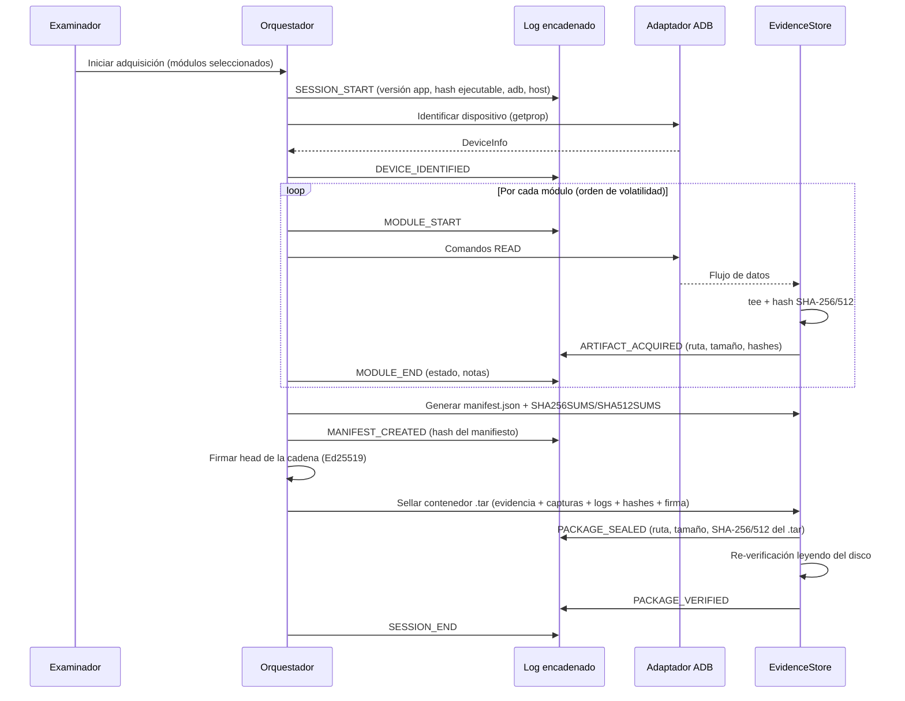

# AGENTE.md — JullForensics

> **Especificación para el agente de desarrollo**
> Aplicación de **extracción lógica de dispositivos Android** para **Kali Linux**, escrita **exclusivamente en Python**, con registro (log) y hash **automáticos**, alineada con normas internacionales de informática forense (ISO/IEC 27037, 27041, 27042, 27043, 27050) y con normas de ciberseguridad (ISO/IEC 27001/27002, NIST SSDF, OWASP). Interfaz gráfica con **diseño brutalista** que cumple estándares UX/UI (ISO 9241, WCAG 2.2 AA).

---

## 0. Cómo debe usar este documento el agente

1. Leer el documento completo antes de escribir código.
2. Ejecutar las **etapas en orden** (Sección 6). Ninguna etapa se cierra sin cumplir su **Definición de Terminado (DoD)**.
3. Las reglas marcadas como **DEBE / NO DEBE** son obligatorias. Las marcadas como **DEBERÍA** son recomendaciones fuertes; si se omiten, se documenta el motivo en `docs/decisiones/ADR-XXX.md`.
4. Ante cualquier conflicto entre funcionalidad y **integridad de la evidencia**, gana siempre la integridad de la evidencia.
5. Todo el código, comentarios técnicos e identificadores en **inglés**; la interfaz, los informes y la documentación de usuario en **español** (con i18n preparada).

---

## 1. Rol del agente

Eres un **ingeniero de software forense senior** especializado en Python, Android (ADB) y seguridad. Tu misión es construir **JullForensics**, una herramienta que:

- Detecta y identifica dispositivos Android conectados por USB (ADB).
- Realiza **adquisición lógica** (no física, sin root, sin explotación de vulnerabilidades).
- Calcula **hashes** de cada artefacto adquirido en el momento de la adquisición.
- Genera **logs automáticos, encadenados criptográficamente e inalterables** (tamper-evident).
- Mantiene la **cadena de custodia** digital del caso.
- Produce un **informe forense** reproducible y verificable.

### Fuera de alcance (NO DEBE implementarse)

- Desbloqueo de pantalla, bypass de FRP, fuerza bruta de PIN/patrón.
- Explotación de vulnerabilidades, rooting, flasheo, *APK downgrade* u otras técnicas que alteren aplicaciones del dispositivo.
- Extracción física / chip-off / JTAG.
- Exfiltración remota, acceso a cuentas en la nube o *scraping* de redes sociales.
- Cualquier función que opere sin una **autorización legal registrada** en el caso.

---

## 2. Proyecto de referencia (uso únicamente referencial)

Se analizó **AvillaForensics** (<https://github.com/AvillaDaniel/AvillaForensics>, C# / WinForms / Windows) **solo como referencia conceptual** para dos aspectos: el flujo de extracción y la asignación automática de logs y hashes. **No se copia ni se traduce su código.**

### 2.1 Lo que se observó

| Aspecto | Implementación en AvillaForensics | Decisión en JullForensics |
|---|---|---|
| Lenguaje / SO | C#, WinForms, `adb.exe` en Windows | Python 3.11+, PySide6, `adb` de los repositorios de Kali |
| Ejecución de ADB | `Process` + `cmd`/PowerShell con cadenas concatenadas | `subprocess.run([...])` con lista de argumentos, **sin `shell=True`**, lista blanca de comandos |
| Identificación del equipo | `getprop ro.boot.serialno`, `ro.build.version.release`, `ro.product.model` tras la extracción | Ampliado (fabricante, SDK, parche de seguridad, huella de build, estado de cifrado, IMEI si accesible) y capturado **antes** de adquirir |
| Adquisición | `adb backup -apk -obb -system -all -shared`, `adb shell find /sdcard/` + `adb pull -a` | Mismos conceptos como módulos independientes, con manifiesto y hash por archivo |
| Hash | MD5 + SHA-256 del `.ab`; módulo aparte con `Get-FileHash` | **SHA-256 + SHA-512** obligatorios por archivo, en streaming, al momento de adquirir. MD5/SHA-1 solo opcionales por compatibilidad |
| Logs | `Logs_Ferramenta.txt` (volcado del textbox) + `Logs_Coleta.txt` con el hash del log de la herramienta | Log estructurado **JSONL**, cada entrada encadenada con hash anterior + **HMAC-SHA256**; manifiesto final firmado (**Ed25519**) |
| Fechas | Hora local `dd-MM-yyyy HH-mm-ss` | **UTC ISO 8601** + zona horaria del examinador + desfase reloj host/dispositivo |
| Cambios en el dispositivo | Modifica `settings` (`verifier_verify_adb_installs`, `package_verifier_enable`, `stay_on_while_plugged_in`) | Cualquier comando que **escriba** en el dispositivo se clasifica como **intrusivo**: requiere confirmación, se registra valor previo y se revierte |

### 2.2 Lecciones aplicadas

- El patrón “log de la herramienta + log de colecta que contiene el hash del log de la herramienta” es valioso: se generaliza a una **cadena de hashes** sobre todas las entradas.
- La adquisición parcial es válida bajo el **principio de suficiencia** (ISO/IEC 27037), siempre que se documente su alcance y limitaciones.
- `adb backup` está **obsoleto** y, desde Android 12 (apps con `targetSdk ≥ 31`), apenas devuelve datos de aplicaciones: el módulo DEBE advertirlo y registrar el resultado real.

### 2.3 Flujo operativo de AvillaForensics analizado y optimizado

El flujo que el examinador percibe en AvillaForensics es: **(1)** la herramienta muestra cuándo hay un dispositivo conectado → **(2)** permite hacer capturas de pantalla → **(3)** hace la copia lógica, la guarda en local como `.tar` y deja los datos de log y hash de esa copia. El análisis del código muestra:

| Paso | Implementación observada | Debilidades detectadas | Optimización en JullForensics |
|---|---|---|---|
| 1. Conexión | `adb devices -l` al abrir formularios o pulsar botón; salida cruda en un label | Sondeo manual, sin estados, sin registro, sin control de identidad | **Monitor push** con `adb track-devices -l`, máquina de estados, barra de estado permanente, eventos en log, vinculación explícita serial + fingerprint (§4B.1) |
| 2. Capturas | `cmd.exe` con `adb exec-out screencap -p > archivo`; PNG/JPG; scroll con `input swipe` fijo; OCR Tesseract | Redirección vía shell, JPG con pérdida, sin hash inmediato, sin metadatos, inyección de toques sin registro | Bytes directo a Python, PNG original, hash en memoria antes de escribir, JSON de metadatos, detección `FLAG_SECURE`, scroll como acción intrusiva auditada (§4B.2) |
| 3. Copia lógica `.tar` | `adb backup` → `.ab` → `java -jar abe.jar unpack` → `.tar`; MD5/SHA-256 después; `Logs_Ferramenta.txt` y `Logs_Coleta.txt` | Depende de Java, doble espacio en disco, `.ab` casi vacío en Android 12+, hash calculado a posteriori, logs no encadenados | **Contenedor JF-TAR** en una sola pasada (stream `tar` del dispositivo o por archivo), hash por archivo + del contenedor durante la escritura, log/hashes/manifiesto/firma dentro, *sidecars* con el hash del `.tar`, re-verificación automática (§4B.3) |

---

## 3. Marco normativo

### 3.1 Informática forense

| Norma / guía | Aplicación concreta en la app |
|---|---|
| **ISO/IEC 27037:2012** — Identificación, recolección, adquisición y preservación de evidencia digital | Flujo identificar → adquirir → preservar; principios de **relevancia, fiabilidad y suficiencia**; minimización de cambios; documentación de cada acción |
| **ISO/IEC 27041:2015** — Idoneidad y adecuación de métodos de investigación | Etapa de **validación**: pruebas con dispositivos de referencia, conjuntos de datos conocidos, informe de validación por versión |
| **ISO/IEC 27042:2015** — Análisis e interpretación de evidencia digital | Separación estricta adquisición/análisis; la app solo **adquiere y documenta**; reproducibilidad |
| **ISO/IEC 27043:2015** — Principios y procesos de investigación de incidentes | Modelo de procesos: preparación → adquisición → preservación → informe → cierre |
| **ISO/IEC 27050** (partes 1–4) — Descubrimiento electrónico | Metadatos de exportación, trazabilidad e identificación única de artefactos |
| **ISO/IEC 17025:2017** | Requisitos de laboratorio: trazabilidad, control de versiones de la herramienta, registros técnicos |
| **RFC 3227** | Orden de volatilidad (propiedades y estado del sistema antes que archivos) |
| **NIST SP 800-101 Rev.1** | Niveles de extracción de dispositivos móviles (la app opera en nivel “extracción lógica”) |
| **NIST SP 800-86** | Integración de técnicas forenses en respuesta a incidentes |
| **SWGDE Best Practices for Mobile Device Evidence** / **ACPO** | Buenas prácticas de manejo y documentación |

### 3.2 Ciberseguridad y desarrollo seguro

| Norma / guía | Aplicación |
|---|---|
| **ISO/IEC 27001:2022 / 27002:2022** | Controles: 8.24 criptografía, 8.25–8.28 desarrollo seguro, 8.15 registro, 8.16 monitorización, 5.33 protección de registros |
| **NIST SP 800-218 (SSDF)** | Ciclo de desarrollo seguro: revisión, análisis estático, gestión de dependencias, SBOM |
| **OWASP ASVS 4.0 (nivel 2)** | Validación de entradas, almacenamiento seguro, registro, criptografía |
| **CWE Top 25** | Evitar inyección de comandos (CWE-78), path traversal (CWE-22), uso de criptografía débil (CWE-327) |
| **NIST SP 800-131A / FIPS 180-4 / FIPS 197** | Algoritmos aprobados: SHA-256/512, AES-256-GCM, HMAC-SHA256 |
| **ISO 9241-110 / 9241-210** + **WCAG 2.2 AA** | Ergonomía, diseño centrado en el usuario y accesibilidad |

> [!IMPORTANT]
> La app DEBE impedir iniciar una adquisición si no se ha registrado en el caso la **base legal** (orden judicial, consentimiento informado o mandato equivalente), el número de expediente y la identidad del examinador.

---

## 4. Principios de diseño obligatorios

1. **Integridad primero**: todo artefacto se hashea mientras se escribe (streaming), nunca después “a mano”.
2. **Mínima intervención**: solo comandos de **lectura** por defecto. Los comandos intrusivos están deshabilitados salvo confirmación explícita.
3. **Trazabilidad total**: cada acción (usuario o sistema) genera una entrada de log encadenada.
4. **Reproducibilidad**: se registra versión de la app, hash del ejecutable, versión de `adb`, versión de Python, SO del host y parámetros exactos de cada comando.
5. **Solo-agregar (append-only)**: los logs y la evidencia se escriben una vez; después se marcan como de solo lectura (`chmod 0440`).
6. **Fallo seguro**: ante un error, se detiene el módulo, se registra y se continúa solo si no compromete la integridad.
7. **Sin red** durante la adquisición (modo offline por defecto). Funciones con red (sellado de tiempo RFC 3161) son opcionales y explícitas.
8. **Mínimo privilegio**: la app NO se ejecuta como root; el usuario pertenece al grupo `plugdev` con reglas udev.

---

## 5. Arquitectura

### 5.1 Stack tecnológico (100 % Python)

| Capa | Tecnología |
|---|---|
| Lenguaje | Python **3.11+** (Kali Rolling incluye 3.12/3.13) |
| GUI | **PySide6** (Qt 6, licencia LGPL) + hoja de estilos QSS generada desde Python |
| Modelo de datos | `pydantic` v2 (validación estricta) + `sqlite3` (stdlib) para el índice del caso |
| Criptografía | `hashlib` (stdlib), `hmac` (stdlib), `cryptography` (AES-256-GCM, Ed25519), `hashlib.scrypt` para derivación de claves |
| Comunicación con el dispositivo | binario `adb` de Kali (`apt install adb`) invocado vía `subprocess`; opcional `adb-shell` (Python puro) como *backend* alternativo |
| Informes | `jinja2` (HTML) + `reportlab` (PDF) + JSON |
| Calidad | `pytest`, `pytest-qt`, `hypothesis`, `ruff`, `mypy --strict`, `bandit`, `pip-audit`, `cyclonedx-bom` |
| Empaquetado | `pyproject.toml` (hatchling), `.deb` para Kali, entrada `.desktop` |

### 5.2 Arquitectura en capas (hexagonal)



### 5.3 Estructura de carpetas

```text
JullForensics/
├── agente.md
├── pyproject.toml
├── README.md
├── SECURITY.md
├── LICENSE
├── packaging/
│   ├── debian/                 # control, postinst, rules
│   ├── jullforensics.desktop
│   └── 51-android-forensics.rules
├── docs/
│   ├── decisiones/             # ADR-001.md, ...
│   ├── validacion/             # Informes ISO/IEC 27041 por versión
│   └── manual_usuario.md
├── src/jullforensics/
│   ├── __main__.py
│   ├── config.py
│   ├── domain/
│   │   ├── case.py             # Case, Examiner, LegalBasis
│   │   ├── device.py           # DeviceInfo
│   │   ├── artifact.py         # Artifact, HashSet
│   │   └── custody.py          # CustodyEvent
│   ├── integrity/
│   │   ├── hashing.py          # hash en streaming multi-algoritmo
│   │   ├── chained_log.py      # log JSONL encadenado + HMAC
│   │   ├── keys.py             # derivación y custodia de claves
│   │   ├── signing.py          # Ed25519 del manifiesto
│   │   └── verify.py           # verificación independiente
│   ├── adb/
│   │   ├── runner.py           # wrapper seguro de subprocess
│   │   ├── allowlist.py        # comandos permitidos y su clasificación
│   │   ├── device_monitor.py   # adb track-devices: estado en tiempo real
│   │   └── device_probe.py     # identificación (getprop, batería)
│   ├── acquisition/
│   │   ├── base.py             # AcquisitionModule (interfaz)
│   │   ├── device_props.py
│   │   ├── packages.py
│   │   ├── system_dumps.py     # dumpsys, settings, logcat
│   │   ├── content_providers.py# contactos, SMS, llamadas (best effort)
│   │   ├── shared_storage.py   # /sdcard con pull -a
│   │   ├── screenshot.py       # capturas forenses (exec-out screencap)
│   │   ├── strategies/         # A: stream tar · B: por archivo · C: adb backup
│   │   ├── ab_converter.py     # .ab → tar en Python puro (sin Java)
│   │   ├── adb_backup.py       # legado, con advertencia
│   │   └── bugreport.py
│   ├── storage/
│   │   ├── evidence_store.py
│   │   ├── tar_container.py    # contenedor JF-TAR + sidecars
│   │   ├── name_sanitizer.py   # anti tar-slip (CWE-22)
│   │   └── case_db.py
│   ├── reporting/
│   │   ├── templates/
│   │   ├── html_report.py
│   │   └── pdf_report.py
│   ├── services/               # casos de uso orquestadores
│   └── ui/
│       ├── theme/
│       │   ├── tokens.py       # tokens de diseño brutalista
│       │   └── qss.py          # generación de QSS
│       ├── adapters/           # puente núcleo → señales Qt (device_signals.py)
│       ├── widgets/            # DeviceStatusBar, ScreenshotGallery, …
│       ├── views/
│       └── main_window.py
└── tests/
    ├── unit/
    ├── integration/
    ├── fixtures/               # salidas ADB simuladas
    └── validation/             # datasets de referencia (ISO 27041)
```

---

## 6. Etapas de desarrollo

> Cada etapa entrega: código + pruebas + documentación + entrada en `CHANGELOG.md`. Ninguna etapa avanza con pruebas en rojo.

```mermaid
flowchart LR
    E0["E0 Preparación"] --> E1["E1 Núcleo de integridad"]
    E1 --> E2["E2 Adaptador ADB seguro"]
    E2 --> E3["E3 Gestión de caso y custodia"]
    E3 --> E4["E4 Módulos de adquisición"]
    E4 --> E4B["E4B Conexión, capturas y .tar"]
    E4B --> E5["E5 Orquestación y log automático"]
    E5 --> E6["E6 Informes"]
    E6 --> E7["E7 UI brutalista"]
    E7 --> E8["E8 Validación ISO 27041"]
    E8 --> E9["E9 Empaquetado Kali"]
    E9 --> E10["E10 Endurecimiento y release"]
```



---

### ETAPA 0 — Preparación, gobierno y entorno

**Objetivo:** dejar listo el repositorio, el entorno de Kali y las reglas de calidad.

Tareas:
1. Crear `pyproject.toml` con dependencias **fijadas** (versiones exactas) y `requirements.lock` con hashes (`pip-compile --generate-hashes`).
2. Entorno en Kali (respetando PEP 668, sin `pip` global):
   ```bash
   sudo apt update && sudo apt install -y adb python3-venv python3-dev
   python3 -m venv .venv && source .venv/bin/activate
   pip install --require-hashes -r requirements.lock
   ```
3. Reglas udev y grupo:
   ```bash
   sudo cp packaging/51-android-forensics.rules /etc/udev/rules.d/
   sudo udevadm control --reload-rules
   sudo usermod -aG plugdev "$USER"
   ```
4. Configurar `ruff`, `mypy --strict`, `bandit`, `pre-commit` y CI (GitHub Actions) con: lint, tipos, pruebas, `pip-audit`, SBOM.
5. Redactar `SECURITY.md` (política de divulgación de vulnerabilidades) y `docs/decisiones/ADR-001-stack.md`.
6. Definir el **modelo de amenazas** (STRIDE) en `docs/threat_model.md`: manipulación de evidencia, repudio, inyección de comandos, fuga de datos del caso, dependencias comprometidas.

**DoD:** CI en verde con proyecto vacío; `adb version` detectado; modelo de amenazas aprobado.

---

### ETAPA 1 — Núcleo de integridad (hash, log encadenado, firma)

**Objetivo:** construir primero lo que garantiza la validez legal de todo lo demás.

#### 1.1 Hash en streaming multi-algoritmo

- Algoritmos obligatorios: **SHA-256** y **SHA-512**. Opcionales: SHA3-256, MD5 y SHA-1 (estos dos últimos marcados como “solo compatibilidad”, CWE-327).
- Lectura en bloques de 1 MiB; un solo recorrido calcula todos los algoritmos.
- Función `tee`: escribir a disco **y** hashear a la vez mientras llegan los datos desde `adb`.

```python
# src/jullforensics/integrity/hashing.py
from __future__ import annotations

import hashlib
from collections.abc import Iterable
from pathlib import Path
from typing import BinaryIO

CHUNK = 1024 * 1024
DEFAULT_ALGOS: tuple[str, ...] = ("sha256", "sha512")


class MultiHasher:
    def __init__(self, algos: Iterable[str] = DEFAULT_ALGOS) -> None:
        self._h = {a: hashlib.new(a) for a in algos}
        self.size = 0

    def update(self, data: bytes) -> None:
        self.size += len(data)
        for h in self._h.values():
            h.update(data)

    def hexdigests(self) -> dict[str, str]:
        return {a: h.hexdigest() for a, h in self._h.items()}


def hash_file(path: Path, algos: Iterable[str] = DEFAULT_ALGOS) -> dict[str, str]:
    mh = MultiHasher(algos)
    with path.open("rb") as fh:
        while chunk := fh.read(CHUNK):
            mh.update(chunk)
    return mh.hexdigests()


def tee_stream(src: BinaryIO, dst: BinaryIO, hasher: MultiHasher) -> None:
    """Copy src -> dst while hashing, so the hash reflects exactly what was written."""
    while chunk := src.read(CHUNK):
        dst.write(chunk)
        hasher.update(chunk)
    dst.flush()
```

#### 1.2 Log encadenado (tamper-evident)

Formato **JSON Lines**, una entrada por evento:

```json
{"seq": 42, "ts_utc": "2026-11-11T19:08:32.123456Z", "case_id": "JF-2026-0007",
 "examiner": "j.perez", "event": "ARTIFACT_ACQUIRED", "module": "shared_storage",
 "data": {"path": "evidence/sdcard/DCIM/IMG_001.jpg", "size": 2381120,
          "sha256": "…", "sha512": "…", "device_mtime": "2026-10-02T14:22:10Z"},
 "prev_hash": "<sha256 de la entrada 41>", "entry_hash": "<sha256 de esta entrada sin HMAC>",
 "hmac": "<HMAC-SHA256(clave_caso, entry_hash)>"}
```

Reglas:
- `entry_hash = SHA-256(JSON canónico sin los campos entry_hash y hmac)` — JSON canónico: `sort_keys=True`, `separators=(",", ":")`, UTF-8.
- `prev_hash` de la primera entrada = SHA-256 del bloque génesis (case_id + hash del ejecutable + timestamp).
- Escritura con `os.fsync` tras cada entrada; archivo abierto en modo `"a"`.
- **Clave HMAC** por caso derivada con `hashlib.scrypt` (n=2¹⁵, r=8, p=1) a partir de la frase de paso del examinador + sal aleatoria de 16 bytes; la clave **nunca** se escribe en disco.
- Al cerrar el caso: el `head` (último `entry_hash`) se firma con **Ed25519** y se incluye en el informe.

```python
# src/jullforensics/integrity/chained_log.py (núcleo)
import hashlib, hmac, json, os
from datetime import datetime, timezone

def _canonical(obj: dict) -> bytes:
    return json.dumps(obj, sort_keys=True, separators=(",", ":"), ensure_ascii=False).encode()

class ChainedLog:
    def __init__(self, path, key: bytes, genesis_hash: str, case_id: str, examiner: str):
        self._path, self._key = path, key
        self._prev, self._seq = genesis_hash, 0
        self._case_id, self._examiner = case_id, examiner

    def append(self, event: str, module: str, data: dict) -> str:
        self._seq += 1
        entry = {
            "seq": self._seq,
            "ts_utc": datetime.now(timezone.utc).isoformat(timespec="microseconds").replace("+00:00", "Z"),
            "case_id": self._case_id, "examiner": self._examiner,
            "event": event, "module": module, "data": data, "prev_hash": self._prev,
        }
        entry_hash = hashlib.sha256(_canonical(entry)).hexdigest()
        entry["entry_hash"] = entry_hash
        entry["hmac"] = hmac.new(self._key, entry_hash.encode(), hashlib.sha256).hexdigest()
        with open(self._path, "a", encoding="utf-8") as fh:
            fh.write(json.dumps(entry, ensure_ascii=False) + "\n")
            fh.flush(); os.fsync(fh.fileno())
        self._prev = entry_hash
        return entry_hash
```

#### 1.3 Verificador independiente

- `jullforensics-verify <carpeta_caso>`: herramienta CLI que recalcula la cadena, los HMAC, la firma Ed25519 y el hash de cada artefacto contra el manifiesto. Debe funcionar **sin la GUI** para que un perito contrario pueda verificar.

**DoD:** pruebas con `hypothesis` que demuestran que alterar **un byte** de cualquier entrada, reordenar, insertar o eliminar entradas se detecta; cobertura ≥ 95 % en `integrity/`.

---

### ETAPA 2 — Adaptador ADB seguro

**Objetivo:** única puerta de comunicación con el dispositivo, segura frente a inyección y auditada.

Reglas:
- `subprocess.run([adb, "-s", serial, *args], shell=False, timeout=…, capture_output=True)`. **NUNCA** `shell=True` ni `os.system`.
- Ruta de `adb` resuelta con `shutil.which` y su **hash SHA-256 + versión** registrados al inicio.
- **Lista blanca** de comandos con clasificación:

| Clase | Ejemplos | Política |
|---|---|---|
| `HOST` | `start-server`, `track-devices -l`, `devices -l`, `version` | Permitido (no tocan el dispositivo) |
| `READ` | `getprop`, `pm list packages`, `dumpsys <servicio>`, `settings get/list`, `ls`, `stat`, `find`, `df`, `pull -a`, `content query`, `logcat -d`, `exec-out screencap -p`, `exec-out cat <ruta>`, `exec-out tar -cf - -C <dir> .`, `wm size` / `wm density` **sin argumentos** | Permitido |
| `READ_HEAVY` | `bugreportz`, `backup` | Permitido con aviso de duración/impacto |
| `INTRUSIVE` | `settings put global stay_on_while_plugged_in`, `input swipe` / `input keyevent` (scroll de capturas) | Deshabilitado por defecto; confirmación modal; se guarda valor previo; se revierte al finalizar; se registra en log y en informe |
| `FORBIDDEN` | `install`, `uninstall`, `rm`, `reboot`, `root`, `remount`, `flash`, `sideload`, `pm clear`, `screencap <ruta>` / `screenrecord <ruta>` (escriben en el dispositivo), `wm size <valor>`, `tar` con `-x` o destino distinto de `-` | Bloqueado siempre |

- Validación de argumentos: rutas del dispositivo con `PurePosixPath`, sin `..`, sin metacaracteres de shell (``;|&`$<>\n``) ; los argumentos que viajan a `adb shell` se escapan con `shlex.quote`.
- Rutas locales: resueltas y comprobadas dentro de la carpeta del caso (anti path traversal, CWE-22).
- Cada invocación genera entradas `ADB_CMD_START` / `ADB_CMD_END` en el log con: argumentos, código de salida, duración, SHA-256 de stdout/stderr.

```python
# src/jullforensics/adb/runner.py (fragmento)
import shlex, subprocess, time, hashlib
from .allowlist import classify, CommandClass, ForbiddenCommandError

class AdbRunner:
    def __init__(self, adb_path: str, serial: str, log, intrusive_ok=lambda cmd: False):
        self._adb, self._serial, self._log, self._intrusive_ok = adb_path, serial, log, intrusive_ok

    def run(self, *args: str, timeout: int = 120) -> subprocess.CompletedProcess[bytes]:
        cls = classify(args)
        if cls is CommandClass.FORBIDDEN:
            self._log.append("ADB_CMD_BLOCKED", "adb", {"args": list(args)})
            raise ForbiddenCommandError(args)
        if cls is CommandClass.INTRUSIVE and not self._intrusive_ok(args):
            raise PermissionError("Intrusive command not authorized by examiner")
        argv = [self._adb, "-s", self._serial, *args]
        self._log.append("ADB_CMD_START", "adb", {"argv": argv, "class": cls.value})
        t0 = time.monotonic()
        cp = subprocess.run(argv, shell=False, capture_output=True, timeout=timeout, check=False)
        self._log.append("ADB_CMD_END", "adb", {
            "rc": cp.returncode, "secs": round(time.monotonic() - t0, 3),
            "stdout_sha256": hashlib.sha256(cp.stdout).hexdigest(),
            "stderr_sha256": hashlib.sha256(cp.stderr).hexdigest(),
        })
        return cp
```

**DoD:** pruebas de inyección (fuzzing de argumentos) sin ejecución arbitraria; `bandit` sin hallazgos de severidad media o alta; *mock* de `adb` para pruebas sin dispositivo.

---

### ETAPA 3 — Gestión de caso y cadena de custodia

**Objetivo:** modelar el caso conforme a ISO/IEC 27037 antes de tocar el dispositivo.

Datos obligatorios del caso (`pydantic`, validación estricta):

- `case_id` (formato configurable, p. ej. `JF-AAAA-NNNN`), organismo, número de expediente.
- **Base legal**: tipo (`ORDEN_JUDICIAL`, `CONSENTIMIENTO`, `MANDATO_FISCAL`, `OTRO`), referencia, fecha, documento adjunto (se hashea al adjuntarlo).
- Examinador: nombre, identificación, rol; testigos opcionales.
- Descripción física del dispositivo: marca, modelo, color, estado, IMEI de etiqueta, SIM/microSD presentes, fotografías (hasheadas).
- Estado al recibir: encendido/apagado, bloqueado/desbloqueado, modo avión, batería.
- Hora del host sincronizada (comprobar NTP si hay red; si no, registrar “sin verificación”).

Cadena de custodia: cada transferencia/acción genera un `CustodyEvent` (quién, qué, cuándo, dónde, por qué, hash del estado) que también se escribe en el log encadenado.

Estructura de carpeta del caso:

```text
JF-2026-0007/
├── case.json                 # metadatos (hash registrado en el log)
├── custody/                  # adjuntos: orden, fotos (hasheados)
├── evidence/                 # artefactos adquiridos (solo lectura al cerrar)
├── logs/
│   ├── chain.jsonl           # log encadenado
│   └── tool_debug.log        # log técnico (sin datos sensibles)
├── screenshots/              # capturas PNG + metadatos JSON
├── manifest.json             # lista de artefactos + hashes
├── manifest.sig              # firma Ed25519
├── export/                   # contenedor .tar sellado + sidecars (Etapa 4B.3)
└── report/                   # HTML, PDF, JSON
```

**DoD:** imposible iniciar adquisición sin base legal y examinador; `case.json` validado por esquema; eventos de custodia visibles en el log.

---

### ETAPA 4 — Módulos de adquisición lógica

**Objetivo:** implementar cada técnica como un **plugin** independiente con interfaz común.

```python
# src/jullforensics/acquisition/base.py
from abc import ABC, abstractmethod
from dataclasses import dataclass

@dataclass(frozen=True)
class ModuleResult:
    module: str
    status: str            # OK | PARTIAL | FAILED | SKIPPED
    artifacts: list[str]   # rutas relativas al caso
    notes: list[str]       # limitaciones encontradas (p. ej., permiso denegado)

class AcquisitionModule(ABC):
    name: str
    description: str
    order_of_volatility: int   # RFC 3227: menor = más volátil, se ejecuta antes
    intrusive: bool = False

    @abstractmethod
    def precheck(self, ctx) -> list[str]: ...      # avisos antes de ejecutar
    @abstractmethod
    def acquire(self, ctx) -> ModuleResult: ...    # DEBE usar ctx.store para escribir (hash automático)
```

Módulos (ordenados por volatilidad, RFC 3227):

| # | Módulo | Comandos (clase READ salvo indicación) | Artefactos |
|---|---|---|---|
| 1 | `device_props` | `getprop`, `date +%s` (desfase de reloj), `dumpsys battery`, `dumpsys telephony.registry` | `device/getprop.txt`, `device/clock_offset.json` |
| 2 | `system_dumps` | `dumpsys` (lista seleccionable: `activity`, `package`, `account`, `usagestats`, `wifi`, `connectivity`, `notification`), `settings list global/secure/system`, `logcat -d -b all` | `system/dumpsys_*.txt`, `system/settings_*.txt`, `system/logcat.txt` |
| 3 | `packages` | `pm list packages -f -i -U --show-versioncode`, `dumpsys package <pkg>` | `apps/packages.csv` (+ opcional `pull` de APK de terceros) |
| 4 | `content_providers` | `content query --uri content://contacts/phones`, `content://call_log/calls`, `content://sms` (best effort: si el usuario `shell` no tiene permiso, registrar `PARTIAL`) | `providers/*.csv` + crudo |
| 5 | `shared_storage` | Estrategias A/B/C de la **Etapa 4B.3** (stream `tar` del dispositivo o `find -print0` + `exec-out cat`), escritas directamente en el contenedor `.tar` | `evidence/sdcard/**` + índice en `manifest.json` (ruta, tamaño, mtime en dispositivo, hashes) |
| 6 | `bugreport` | `bugreportz` (READ_HEAVY) | `bugreport/bugreport.zip` |
| 7 | `adb_backup` (legado) | `backup -apk -obb -shared -all` (READ_HEAVY, requiere aceptar en pantalla) + conversor `.ab → tar` nativo en Python | `evidence/adb_backup/backup.ab` + miembros convertidos + advertencia en informe sobre Android 12+ |
| 8 | `screenshot` | `exec-out screencap -p` (Etapa 4B.2) | `screenshots/NNNN_<UTC>.png` + `.json` |

Requisitos para todos los módulos:
- Escribir **solo** a través de `EvidenceStore.write_stream()` / `put_file()`, que calcula hashes y registra `ARTIFACT_ACQUIRED` automáticamente (no se permite escribir evidencia por otra vía).
- Para `pull` de archivos: tras descargar, recalcular hash local y comparar tamaño con `stat` del dispositivo; discrepancia → `INTEGRITY_WARNING`.
- Registrar `MODULE_START`, `MODULE_END` con estado y notas.
- Ser **cancelables** de forma segura (la cancelación se registra y el artefacto incompleto se marca `INCOMPLETE`, nunca se borra).
- Soportar reanudación: artefactos ya hasheados no se vuelven a descargar.

**DoD:** cada módulo con pruebas unitarias sobre salidas ADB simuladas (`tests/fixtures/`) y prueba de integración con al menos un dispositivo/emulador real (AVD de Android 11, 13 y 15).

---

### ETAPA 4B — Flujo núcleo: conexión en vivo → capturas de pantalla → copia lógica en `.tar` forense

**Objetivo:** reproducir y **optimizar** el flujo operativo principal observado en AvillaForensics (ver §2.3): (1) mostrar cuándo el dispositivo está conectado, (2) tomar capturas de pantalla una vez conectado y (3) realizar la copia lógica guardándola en un `.tar` local que **incluye** los logs y los hashes correspondientes.



#### 4B.1 Monitor de conexión en tiempo real

| | AvillaForensics | JullForensics (optimizado) |
|---|---|---|
| Mecanismo | `adb devices -l` al pulsar un botón (sondeo manual) | `adb track-devices -l`: flujo **push** permanente del servidor ADB, sin sondeo ni botón “refrescar” |
| Latencia | Depende del usuario | < 1 s desde que se conecta/desconecta/autoriza |
| Estados | Texto crudo en un label | Máquina de estados: `ABSENT → UNAUTHORIZED → DEVICE`, `OFFLINE`, `RECOVERY/SIDELOAD/BOOTLOADER` (no soportados) |
| Registro | No | Cada transición genera `DEVICE_CONNECTED` / `DEVICE_STATE_CHANGED` / `DEVICE_DISCONNECTED` en el log encadenado |
| Identidad | No se verifica | Al pasar a `device` se identifica automáticamente (solo lectura); al reconectar se comprueba que `serial` + `ro.build.fingerprint` coinciden con el dispositivo vinculado |

Diseño:
- `adb/device_monitor.py`: hilo dedicado que lanza `adb track-devices -l` y lee **tramas** (`4 dígitos hex de longitud` + lista completa de dispositivos). Cada trama se compara con la anterior para obtener altas, bajas y cambios de estado.
- El núcleo es independiente de Qt (callbacks); `ui/adapters/device_signals.py` lo convierte en `Signal(DeviceEvent)` para la barra de estado.
- Si el servidor ADB cae, reinicio con *backoff* exponencial (1, 2, 4… máx. 30 s) y evento `ERROR`. Si `track-devices` no estuviera disponible, *fallback* a `adb devices -l` cada 2 s.
- Al detectar `device`: `DeviceProbe` ejecuta en **una sola llamada** `adb shell getprop` (se parsea completo) + `dumpsys battery`, y rellena el indicador superior (modelo, serial, Android, parche, batería).
- **Vinculación explícita**: el examinador pulsa `VINCULAR AL CASO` → `DEVICE_BOUND` (serial, fingerprint, modelo, IMEI si es legible sin privilegios). Desde ese momento:
  - Todos los comandos llevan `-s <serial>`; nunca se usa el “dispositivo por defecto”.
  - Si aparece otro serial → `UNEXPECTED_DEVICE` y aviso; si reconecta un dispositivo con otro fingerprint → bloqueo.
  - Desconexión durante una adquisición → pausa segura y opción de reanudar (Etapa 5).

```python
# src/jullforensics/adb/device_monitor.py (núcleo de parseo)
from dataclasses import dataclass
from typing import BinaryIO, Iterator

@dataclass(frozen=True)
class DeviceEntry:
    serial: str
    state: str                      # device | unauthorized | offline | recovery | sideload | bootloader
    model: str | None = None
    transport_id: str | None = None

def parse_devices(payload: str) -> dict[str, DeviceEntry]:
    devices: dict[str, DeviceEntry] = {}
    for line in payload.splitlines():
        parts = line.split()
        if len(parts) < 2:
            continue
        serial, state, *rest = parts
        attrs = dict(p.split(":", 1) for p in rest if ":" in p)
        devices[serial] = DeviceEntry(serial, state, attrs.get("model"), attrs.get("transport_id"))
    return devices

def read_frames(stream: BinaryIO) -> Iterator[dict[str, DeviceEntry]]:
    """Each frame from `adb track-devices` = 4 hex chars (length) + full device list."""
    while len(head := stream.read(4)) == 4:
        size = int(head, 16)
        payload = stream.read(size).decode("utf-8", "replace") if size else ""
        yield parse_devices(payload)

def diff(prev: dict[str, DeviceEntry], cur: dict[str, DeviceEntry]) -> list[tuple[str, DeviceEntry | None]]:
    events: list[tuple[str, DeviceEntry | None]] = []
    for s in cur.keys() - prev.keys():
        events.append(("DEVICE_CONNECTED", cur[s]))
    for s in prev.keys() - cur.keys():
        events.append(("DEVICE_DISCONNECTED", prev[s]))
    for s in cur.keys() & prev.keys():
        if cur[s].state != prev[s].state:
            events.append(("DEVICE_STATE_CHANGED", cur[s]))
    return events
```

#### 4B.2 Capturas de pantalla forenses

| | AvillaForensics | JullForensics (optimizado) |
|---|---|---|
| Captura | `cmd.exe` → `adb exec-out screencap -p > archivo` (redirección de shell) | `subprocess.run([adb, "-s", serial, "exec-out", "screencap", "-p"])`: los bytes PNG llegan **directamente a Python**, sin shell ni archivo temporal en el dispositivo |
| Formato | PNG o JPG (JPG = compresión con pérdida) | **Solo PNG original** sin recomprimir; miniaturas derivadas solo para UI/informe, marcadas como derivadas |
| Hash | No en el momento (MD5 al generar el informe) | SHA-256 + SHA-512 **en memoria antes de escribir** en disco |
| Metadatos | Solo la hora en el nombre del archivo | JSON adjunto: secuencia, UTC antes/después, serial, resolución, orientación, actividad en primer plano, nota del examinador, hashes |
| Scroll automático | `input swipe 0 700 0 1350` (coordenadas fijas) | Opción **INTRUSIVA** (inyecta toques): deshabilitada por defecto, confirmación, coordenadas calculadas con `wm size`, cada gesto registrado |
| OCR | Tesseract integrado | Fuera del alcance de la adquisición; futuro módulo de **análisis** (ISO/IEC 27042) sobre copias |

Flujo de `acquisition/screenshot.py`:
1. Precondición: caso activo + dispositivo vinculado en estado `device` (si no, botón deshabilitado con motivo).
2. `ts_before = utc_now()` → `exec-out screencap -p` (timeout 15 s) → `ts_after = utc_now()`.
3. Validar firma PNG (`\x89PNG\r\n\x1a\n`) y leer ancho/alto de la cabecera IHDR con `struct` (sin Pillow).
4. Calcular hashes en memoria → escribir con `EvidenceStore.put_bytes()` en `screenshots/0001_20261111T190832Z.png` (secuencia de 4 dígitos + UTC) → `0001_….json` con metadatos (también hasheado).
5. Contexto (lectura): `dumpsys activity activities` → `topResumedActivity`/`mResumedActivity`; `wm size` y `wm density` **sin argumentos** (con argumentos = escritura = `FORBIDDEN`).
6. Comprobación de captura negra: decodificar con `QImage`; si ≥ 99 % de los píxeles son negros → `SCREENSHOT_WARNING` (“posible `FLAG_SECURE` o pantalla apagada”). La captura se conserva igualmente.
7. Evento `SCREENSHOT_CAPTURED` con secuencia, ruta, hashes y actividad.
8. Antirrebote de 500 ms y atajo `F12`. Ninguna captura se borra: si el examinador la descarta, se marca `DISCARDED` en el log y sigue en el contenedor.

```python
# src/jullforensics/acquisition/screenshot.py (núcleo)
import struct
from datetime import datetime, timezone

PNG_SIG = b"\x89PNG\r\n\x1a\n"

def capture(runner, store, seq: int, note: str = "") -> dict:
    ts_before = datetime.now(timezone.utc)
    cp = runner.run("exec-out", "screencap", "-p", timeout=15)
    ts_after = datetime.now(timezone.utc)
    data = cp.stdout
    if cp.returncode != 0 or not data.startswith(PNG_SIG):
        raise ScreenshotError(f"Invalid screencap output (rc={cp.returncode}, {len(data)} bytes)")
    width, height = struct.unpack(">II", data[16:24])          # IHDR
    name = f"screenshots/{seq:04d}_{ts_before:%Y%m%dT%H%M%SZ}.png"
    digests = store.put_bytes(name, data)                      # hashes BEFORE disk write + ARTIFACT_ACQUIRED
    meta = {"seq": seq, "file": name, "ts_before_utc": ts_before.isoformat(),
            "ts_after_utc": ts_after.isoformat(), "width": width, "height": height,
            "note": note, **digests}
    store.put_json(name.replace(".png", ".json"), meta)
    return meta
```

#### 4B.3 Copia lógica en contenedor forense `.tar` (JF-TAR)

| | AvillaForensics | JullForensics (optimizado) |
|---|---|---|
| Origen del `.tar` | `adb backup` → `.ab` → conversión con `java -jar abe.jar` | Copia lógica **directa** del almacenamiento accesible empaquetada en streaming; `.ab` solo como módulo legado |
| Dependencias | Java + abe.jar | **Python puro** (`tarfile`, `hashlib`, `zlib`, `cryptography`) |
| Espacio en disco | `.ab` + `.tar` (≈ 2× tamaño) | Una sola pasada: dispositivo → hash → `.tar` (≈ 1×) |
| Hashes | MD5 + SHA-256 del archivo completo, calculados **después** releyendo | 3 niveles calculados **durante** la escritura: por archivo, del `.tar` completo y del log; re-verificación posterior desde disco |
| Logs | `Logs_Ferramenta.txt` + `Logs_Coleta.txt` **fuera** del `.tar` | Log encadenado, hashes, manifiesto y firma **dentro** del `.tar` + *sidecars* externos con el hash del propio `.tar` |
| Android 12+ | `.ab` casi vacío sin aviso | Advertencia explícita y estrategia alternativa automática |

**Estrategias de adquisición** (se elige automáticamente, se registra cuál y por qué):

| Estrategia | Cuándo | Cómo |
|---|---|---|
| **A — Stream tar del dispositivo** (rápida) | El dispositivo tiene `tar` (toybox; se **detecta**, no se asume) | `adb exec-out tar -cf - -C /storage/emulated/0 .` → Python lee el flujo con `tarfile.open(fileobj=stdout, mode="r|")` y reescribe cada miembro en el JF-TAR mientras lo hashea. Una sola conexión ADB; `stderr` a archivo (archivos sin permiso) |
| **B — Por archivo** (compatible) | Sin `tar` en el dispositivo, o la estrategia A falla | `exec-out find … -type f -print0` (seguro con nombres raros) → `stat` → `exec-out cat <ruta>` por archivo a `SpooledTemporaryFile` (64 MiB en RAM, después a disco dentro del caso) con hash simultáneo → se añade al tar. Lectura en paralelo (2–4 hilos ADB), **un único hilo escritor** del tar (orden determinista) |
| **C — `adb backup` legado** | Solo si el examinador lo pide (Android ≤ 11 útil) | `.ab` original se conserva y hashea; conversor **nativo en Python** (cabecera, PBKDF2 + AES-256 si cifrado, `zlib`) → miembros reempaquetados en `evidence/adb_backup/` |

**Perfiles de extracción (UX):** `RÁPIDA` (propiedades + capturas + dumps del sistema), `ESTÁNDAR` (+ paquetes + proveedores de contenido + almacenamiento compartido), `COMPLETA` (+ bugreport + backup legado). El examinador puede ajustar módulos; el perfil y los ajustes quedan en el log.

**Estructura interna del `.tar`** (formato **POSIX PAX**, UTF-8, un único directorio raíz, orden fijo):

```text
JF-2026-0007_R58W123ABC_20261111T190832Z.tar
└── JF-2026-0007_R58W123ABC_20261111T190832Z/
    ├── 00_LEEME.txt                 # qué contiene y cómo verificarlo
    ├── evidence/                    # se escribe primero (streaming)
    │   ├── sdcard/…                 # mtime y permisos originales del dispositivo
    │   ├── system/…  apps/…  providers/…  bugreport/…  adb_backup/…
    ├── screenshots/0001_…png  0001_…json  …
    ├── device/device_info.json  getprop.txt
    ├── case/case.json  custody/…    # base legal, fotos (hasheadas)
    ├── logs/
    │   ├── chain.jsonl              # log encadenado hasta PACKAGE_FINALIZING
    │   └── adb_stderr/…             # errores del dispositivo (permisos denegados, etc.)
    └── hashes/                      # se escribe al final
        ├── SHA256SUMS               # compatible con `sha256sum -c`
        ├── SHA512SUMS
        ├── manifest.json            # artefacto, tamaño, hashes, origen, módulo, estrategia
        ├── manifest.sig             # Ed25519 sobre manifest.json (incluye head de la cadena)
        └── signing_pubkey.pem
```

**Sidecars externos** (junto al `.tar`, en `export/`):

```text
JF-…Z.tar
JF-…Z.tar.sha256       # "<hash>  JF-…Z.tar"  → sha256sum -c JF-…Z.tar.sha256
JF-…Z.tar.sha512
JF-…Z.tar.log.jsonl    # log completo, incluye PACKAGE_SEALED y PACKAGE_VERIFIED
JF-…Z.tar.sig          # Ed25519 sobre el SHA-512 del .tar
```

> [!IMPORTANT]
> Un archivo **no puede contener su propio hash** (incluirlo lo cambiaría). Por eso el `.tar` contiene los hashes de **todo su contenido**, y el hash **del `.tar`** se guarda fuera: en los *sidecars*, en el log externo (`PACKAGE_SEALED`) y en el informe.

**Mecánica de escritura (una sola pasada):**
1. **Pre-chequeo**: espacio usado en el dispositivo (`df` de `/storage/emulated/0`) vs. libre en el host (`shutil.disk_usage`) con margen ≥ 10 %; sistema de archivos destino leído de `/proc/mounts` (aviso si es FAT32: límite de 4 GiB por archivo); permisos de escritura.
2. Abrir `export/<nombre>.tar.part` con `O_CREAT | O_EXCL`, `umask 077`.
3. Envolver el archivo en `HashingWriter` (escribe y hashea el `.tar` completo a la vez) y abrir `tarfile.open(fileobj=…, mode="w|", format=tarfile.PAX_FORMAT)`.
4. Por cada archivo: `TarInfo` con tamaño, `mtime` y modo del dispositivo; datos a través de `HashingReader` (hash por archivo); si los bytes leídos ≠ tamaño de `stat` → `INTEGRITY_WARNING` y el archivo se marca en el manifiesto.
5. **Saneamiento de nombres** que vienen del dispositivo (no confiables): normalizar, rechazar rutas absolutas, `..`, bytes nulos y caracteres de control (prevención de *tar slip*, CWE-22); el nombre original se conserva en `manifest.json`.
6. Al terminar la evidencia: `PACKAGE_FINALIZING` → escribir capturas, `device/`, `case/`, `logs/chain.jsonl`, `SHA256SUMS`, `SHA512SUMS`, `manifest.json`, firma.
7. Cerrar tar → `flush` + `fsync` → renombrado **atómico** `.part` → `.tar` → `chmod 0440` → escribir *sidecars* → `PACKAGE_SEALED`.
8. **Re-verificación independiente**: releer el `.tar` desde disco, recalcular su hash y el de cada miembro contra `SHA256SUMS` → `PACKAGE_VERIFIED` (o `INTEGRITY_WARNING`).
9. Cancelación o error: nunca se borra; el `.part` se renombra a `.tar.INCOMPLETE` con su hash y el motivo en el log.
10. Compresión **opcional** (`w|gz` o `w|xz`, stdlib) → `.tar.gz` / `.tar.xz`. Por defecto **sin compresión** (más rápido, el multimedia ya está comprimido y la verificación es más simple).

```python
# src/jullforensics/storage/tar_container.py (núcleo)
import io, tarfile
from jullforensics.integrity.hashing import MultiHasher

class HashingWriter(io.RawIOBase):
    """Writes to the real file and hashes the whole .tar in the same pass."""
    def __init__(self, fh, hasher: MultiHasher) -> None:
        self._fh, self.hasher = fh, hasher
    def writable(self) -> bool:
        return True
    def write(self, b) -> int:
        n = self._fh.write(b)
        self.hasher.update(bytes(memoryview(b)[:n]))
        return n

class HashingReader(io.RawIOBase):
    """Hashes each member while tarfile copies it into the container."""
    def __init__(self, src, hasher: MultiHasher) -> None:
        self._src, self.hasher, self.bytes_read = src, hasher, 0
    def readable(self) -> bool:
        return True
    def read(self, n: int = -1) -> bytes:
        chunk = self._src.read(n)
        self.bytes_read += len(chunk)
        self.hasher.update(chunk)
        return chunk

def add_member(tar: tarfile.TarFile, arcname: str, src, size: int, mtime: int, mode: int) -> dict[str, str]:
    ti = tarfile.TarInfo(arcname)
    ti.size, ti.mtime, ti.mode = size, mtime, mode & 0o777
    reader = HashingReader(src, MultiHasher())
    tar.addfile(ti, reader)          # tarfile copies exactly `size` bytes; short read raises
    return reader.hasher.hexdigests()
```

**Verificación por terceros (sin JullForensics):**

```bash
sha256sum -c JF-…Z.tar.sha256                 # integridad del contenedor
tar -xf JF-…Z.tar && cd JF-…Z/
sha256sum -c hashes/SHA256SUMS                # integridad de cada archivo
```
y con la herramienta propia: `jullforensics-verify JF-…Z.tar` (además valida la cadena del log y las firmas Ed25519).

**DoD de la etapa 4B:**
- El indicador cambia en < 1 s al conectar, autorizar y desconectar (probado con emulador y teléfono real), y cada transición está en el log.
- 100 capturas consecutivas sin pérdida; hash en memoria = hash en disco; ninguna escritura en el dispositivo (verificado comparando el listado de `/sdcard` antes/después).
- Estrategias A y B producen el mismo conjunto de hashes por archivo sobre el mismo dataset de referencia.
- `.tar` extraíble con GNU tar y bsdtar; `sha256sum -c` correcto dentro y fuera; *tar slip* imposible (pruebas con nombres maliciosos simulados).
- Cancelación a mitad deja `.tar.INCOMPLETE` + log coherente; reanudar genera un contenedor nuevo y válido.

---

### ETAPA 5 — Orquestación y asignación automática de log y hash

**Objetivo:** que el examinador no tenga que “acordarse” de generar logs ni hashes: ocurre siempre.

Flujo de un trabajo de adquisición:



Requisitos:
- Ejecución en un `QThread`/`concurrent.futures` separado de la UI; la UI recibe progreso por señales.
- Catálogo cerrado de eventos (`enum EventType`): `SESSION_START`, `CASE_CREATED`, `LEGAL_BASIS_ATTACHED`, `DEVICE_CONNECTED`, `DEVICE_STATE_CHANGED`, `DEVICE_DISCONNECTED`, `DEVICE_IDENTIFIED`, `DEVICE_BOUND`, `UNEXPECTED_DEVICE`, `ADB_CMD_START`, `ADB_CMD_END`, `ADB_CMD_BLOCKED`, `INTRUSIVE_CHANGE`, `INTRUSIVE_REVERTED`, `SCREENSHOT_CAPTURED`, `SCREENSHOT_WARNING`, `MODULE_START`, `MODULE_END`, `ARTIFACT_ACQUIRED`, `INTEGRITY_WARNING`, `PACKAGE_STARTED`, `PACKAGE_FINALIZING`, `PACKAGE_SEALED`, `PACKAGE_VERIFIED`, `USER_ACTION`, `ERROR`, `MANIFEST_CREATED`, `REPORT_GENERATED`, `SESSION_END`, `CASE_CLOSED`.
- Desconexión del dispositivo durante la adquisición → evento `DEVICE_DISCONNECTED` (emitido por el monitor de la Etapa 4B), pausa y opción de reanudar.
- Al cerrar el caso: permisos `0440` en evidencia y logs, `manifest.json` firmado, contenedor `.tar` sellado (Etapa 4B.3) y opción de **cifrado para transporte** (AES-256-GCM sobre el `.tar` → `.tar.jfenc`, conservando el hash del `.tar` en claro).

**DoD:** prueba de extremo a extremo con emulador que produce carpeta de caso completa y `.tar` sellado, y `jullforensics-verify` devuelve `OK` tanto sobre la carpeta como sobre el `.tar`.

---

### ETAPA 6 — Informes forenses

**Objetivo:** documento comprensible por un juez y verificable por un perito.

Contenido mínimo del informe (HTML + PDF + JSON):
1. Portada: caso, expediente, organismo, examinador, fechas (UTC y local).
2. Base legal y referencia al documento (con su hash).
3. Herramienta: nombre, versión, hash del paquete, versión de Python, `adb`, SO del host, informe de validación aplicable (ISO/IEC 27041).
4. Dispositivo: descripción física + propiedades obtenidas, desfase de reloj.
5. Metodología: módulos ejecutados, orden, comandos exactos, cambios intrusivos (si los hubo) y su reversión.
6. Resultados: tabla de artefactos (ruta, tamaño, SHA-256, SHA-512), estado por módulo y **limitaciones** (principio de suficiencia).
7. Cadena de custodia completa.
8. Integridad: `head` de la cadena, firma Ed25519, clave pública, instrucciones de verificación con `jullforensics-verify`.
9. Anexos: log encadenado completo.

El PDF generado se hashea y su hash queda registrado en el log (`REPORT_GENERATED`).

**DoD:** informe generado para el caso de prueba; plantilla revisada contra la checklist de ISO/IEC 27037 §7.

---

### ETAPA 7 — Interfaz gráfica brutalista (PySide6)

**Objetivo:** UI cruda, honesta y directa, **sin sacrificar usabilidad ni accesibilidad**.

#### 7.1 Principios del brutalismo aplicados

- Estructura visible: retícula evidente, bordes gruesos, sin ornamentos.
- Sin degradados, sin desenfoques, sin esquinas redondeadas, sin sombras suaves (solo sombra dura desplazada).
- Tipografía monoespaciada, MAYÚSCULAS en rótulos, jerarquía por tamaño y peso.
- Paleta mínima de alto contraste + un color de acento para acción y uno para alerta.
- El estado del sistema se muestra en texto literal (p. ej. `SHA-256 ✓ VERIFICADO`), no solo con iconos o color.

#### 7.2 Tokens de diseño

```python
# src/jullforensics/ui/theme/tokens.py
from dataclasses import dataclass

@dataclass(frozen=True)
class Tokens:
    # Color (contrastes verificados WCAG 2.2 AA/AAA)
    bg: str = "#F2F2F2"          # fondo
    fg: str = "#0A0A0A"          # texto / bordes  (contraste ≈ 18:1)
    accent: str = "#FFE600"      # acción primaria (texto negro sobre amarillo ≈ 16:1)
    danger: str = "#D7261E"      # error / intrusivo (texto blanco ≈ 5.0:1)
    ok: str = "#00873E"          # verificado (texto blanco ≈ 4.6:1)
    inverse_fg: str = "#FFFFFF"
    # Tipografía
    font_family: str = "JetBrains Mono, IBM Plex Mono, DejaVu Sans Mono, monospace"
    fs_body: int = 14
    fs_label: int = 12
    fs_h2: int = 20
    fs_h1: int = 32
    # Estructura
    border: int = 3              # px
    shadow_offset: int = 6       # sombra dura
    space: int = 8               # unidad base de espaciado (múltiplos de 8)
    target_min: int = 44         # tamaño mínimo de objetivo táctil/clic (WCAG 2.5.8)
    radius: int = 0

TOKENS = Tokens()
```

```python
# src/jullforensics/ui/theme/qss.py
from .tokens import TOKENS as T

def build_qss() -> str:
    return f"""
    * {{ font-family: {T.font_family}; font-size: {T.fs_body}px; color: {T.fg}; }}
    QMainWindow, QWidget {{ background: {T.bg}; }}
    QLabel[role="h1"] {{ font-size: {T.fs_h1}px; font-weight: 800; }}
    QLabel[role="label"] {{ font-size: {T.fs_label}px; font-weight: 700; }}
    QFrame[role="panel"] {{ border: {T.border}px solid {T.fg}; border-radius: {T.radius}px; background: #FFFFFF; }}
    QPushButton {{
        min-height: {T.target_min}px; padding: 0 {T.space * 2}px;
        border: {T.border}px solid {T.fg}; border-radius: 0; background: #FFFFFF;
        font-weight: 800;
    }}
    QPushButton[variant="primary"] {{ background: {T.accent}; }}
    QPushButton[variant="danger"]  {{ background: {T.danger}; color: {T.inverse_fg}; }}
    QPushButton:hover   {{ background: {T.fg}; color: {T.inverse_fg}; }}
    QPushButton:focus   {{ border: {T.border + 2}px solid {T.fg}; }}
    QPushButton:disabled {{ background: {T.bg}; color: #6B6B6B; border-style: dashed; }}
    QLineEdit, QComboBox, QPlainTextEdit {{
        min-height: {T.target_min}px; border: {T.border}px solid {T.fg}; border-radius: 0;
        background: #FFFFFF; padding: 0 {T.space}px;
    }}
    QLineEdit:focus, QComboBox:focus, QPlainTextEdit:focus {{ background: #FFFBD1; }}
    QProgressBar {{ border: {T.border}px solid {T.fg}; height: 28px; text-align: center; font-weight: 800; }}
    QProgressBar::chunk {{ background: {T.fg}; }}
    QTableView {{ border: {T.border}px solid {T.fg}; gridline-color: {T.fg}; }}
    QHeaderView::section {{ background: {T.fg}; color: {T.inverse_fg}; border: 0; padding: {T.space}px; font-weight: 800; }}
    """
```

> **Nota Qt:** QSS no admite `text-transform`, `letter-spacing` ni `box-shadow`. Las MAYÚSCULAS se aplican en Python (`text.upper()` en los widgets propios), el espaciado de letras con `QFont.setLetterSpacing(QFont.AbsoluteSpacing, 1)` y la sombra dura con `QGraphicsDropShadowEffect(blurRadius=0, offset=(6, 6), color=#0A0A0A)` en paneles y botón primario.

#### 7.3 Arquitectura de información y pantallas

```text
┌──────────────────────────────────────────────────────────────────────────┐
│ JULLFORENSICS ▌CASO: JF-2026-0007 ▌EXAMINADOR: J.PEREZ ▌UTC 19:08:32     │
│ ■ DISPOSITIVO: CONECTADO ▌SM-A546E ▌SERIAL R58W…  ▌ANDROID 14 ▌BAT 81 %  │
├───────────────┬──────────────────────────────────────────────────────────┤
│ 01 CASO       │                                                          │
│ 02 DISPOSITIVO│   [ PANTALLA ACTIVA ]                                    │
│ 03 CAPTURAS   │                                                          │
│ 04 ADQUISICIÓN│                                                          │
│ 05 INTEGRIDAD │                                                          │
│ 06 INFORME    │                                                          │
│ 07 CUSTODIA   │                                                          │
├───────────────┴──────────────────────────────────────────────────────────┤
│ LOG ▸ 19:08:31Z ARTIFACT_ACQUIRED sdcard/DCIM/IMG_001.jpg SHA-256 3f…    │
└──────────────────────────────────────────────────────────────────────────┘
```

**Indicador de dispositivo (barra superior, siempre visible):** bloque de color sólido + texto literal.

| Estado ADB | Texto | Fondo / texto |
|---|---|---|
| sin dispositivo | `■ SIN DISPOSITIVO — CONECTE EL TELÉFONO POR USB` | `bg` / `fg` (borde discontinuo) |
| `unauthorized` | `■ NO AUTORIZADO — ACEPTE LA HUELLA RSA EN EL TELÉFONO` | `accent` / `fg` |
| `offline` | `■ SIN RESPUESTA — RECONECTE EL CABLE` | `danger` / blanco |
| `device` | `■ CONECTADO ▌MODELO ▌SERIAL ▌ANDROID ▌BAT` | `ok` / blanco |
| `recovery` / `sideload` / `bootloader` | `■ MODO NO SOPORTADO PARA EXTRACCIÓN LÓGICA` | `danger` / blanco |

| Pantalla | Contenido | Reglas UX |
|---|---|---|
| 01 CASO | Crear/abrir caso, base legal, examinador, adjuntos | Asistente por pasos; botón “CONTINUAR” deshabilitado hasta completar campos obligatorios; errores en línea con texto |
| 02 DISPOSITIVO | Lista de dispositivos en vivo (`adb track-devices`), estado, propiedades, botón “VINCULAR AL CASO” | Instrucción literal según estado; con varios dispositivos se exige elegir uno; sin botón “refrescar” (no hace falta) |
| 03 CAPTURAS | Botón `CAPTURAR [F12]`, galería en cuadrícula de miniaturas con nº de secuencia, hora UTC, SHA-256 abreviado y actividad en primer plano; campo de nota por captura | Deshabilitado si el estado ≠ `device`; aviso automático si la captura sale negra (`FLAG_SECURE`); el scroll automático aparece como opción intrusiva |
| 04 ADQUISICIÓN | Perfil de extracción, selección de módulos (descripción, impacto, duración estimada), espacio libre host/dispositivo, barra de progreso por módulo y global, velocidad MB/s, botón CANCELAR | Módulos intrusivos en rojo con confirmación que exige escribir `CONFIRMO` |
| 05 INTEGRIDAD | Tabla de artefactos y hashes, verificación de cadena en vivo, ficha del contenedor `.tar` (ruta, tamaño, SHA-256/512, estado de re-verificación) | Estado textual `✓ ÍNTEGRO` / `✗ ALTERADO` además del color; botón “COPIAR HASH” |
| 06 INFORME | Vista previa, generar HTML/PDF/JSON | Muestra hash del informe generado |
| 07 CUSTODIA | Línea de tiempo de eventos de custodia | Filtrable, exportable |

#### 7.4 Estándares UX/UI obligatorios

- **ISO 9241-110** (principios de diálogo): adecuación a la tarea, autodescriptividad, conformidad con expectativas, tolerancia a errores (confirmaciones y “deshacer” donde no afecte evidencia), controlabilidad (cancelar siempre visible).
- **Heurísticas de Nielsen**: visibilidad del estado (barra de log permanente), prevención de errores, reconocer antes que recordar.
- **WCAG 2.2 AA**: contraste ≥ 4.5:1 texto y ≥ 3:1 componentes; foco visible (2.4.7, 2.4.11); objetivos ≥ 24 px (se usa 44 px); navegación completa por teclado (`Tab`, atajos `Alt+1…7`, `F12` = captura); no depender solo del color; `setAccessibleName` en todos los widgets.
- Escalado HiDPI y tamaño de fuente ajustable (100–200 %).
- Mensajes de error: qué pasó + por qué + qué hacer (p. ej. `DISPOSITIVO NO AUTORIZADO — ACEPTE LA HUELLA RSA EN LA PANTALLA DEL TELÉFONO Y PULSE REFRESCAR`).
- La UI **nunca** bloquea el hilo principal; operaciones largas siempre en segundo plano.

**DoD:** prueba de usabilidad con 3 usuarios (tareas: crear caso, adquirir, verificar) con tasa de éxito ≥ 90 %; auditoría de contraste y teclado superada; pruebas `pytest-qt` de flujos principales.

---

### ETAPA 8 — Validación forense (ISO/IEC 27041)

**Objetivo:** demostrar que el método es idóneo y que la herramienta hace lo que dice.

1. Definir requisitos verificables (p. ej. “R-07: todo archivo de `/sdcard` adquirido conserva hash idéntico al original”).
2. Preparar **dispositivos/emuladores de referencia** con datos conocidos (archivos con hash precalculado, contactos, SMS, llamadas sembradas).
3. Ejecutar adquisiciones repetidas (≥ 3) y comparar: hashes, recuento de artefactos, metadatos de tiempo.
4. Pruebas negativas: dispositivo desconectado a mitad, almacenamiento lleno en host, permiso denegado, archivos con nombres Unicode/espacios/caracteres especiales, archivos > 4 GiB.
5. Pruebas de manipulación: alterar evidencia/log y confirmar detección.
6. Documentar en `docs/validacion/VAL-<versión>.md`: alcance, entorno, resultados, limitaciones conocidas, tasa de error.

**DoD:** informe de validación firmado y versionado; cada release referencia su informe.

---

### ETAPA 9 — Empaquetado e instalación en Kali Linux

**Objetivo:** instalación reproducible y con mínimo privilegio.

- Paquete `.deb` (`jullforensics_<ver>_all.deb`):
  - `Depends: python3 (>= 3.11), adb, python3-venv`
  - Instala en `/opt/jullforensics` con su propio venv (dependencias con hashes verificados).
  - Lanzador `/usr/bin/jullforensics` y `/usr/bin/jullforensics-verify`.
  - `postinst`: instala reglas udev, recarga udev, **no** añade usuarios automáticamente (lo indica en pantalla).
  - Entrada de menú en la categoría *Forensics* de Kali (`/usr/share/applications/jullforensics.desktop`, `Categories=Utility;Security;`).
- Alternativa: `pipx install jullforensics` (respeta PEP 668).
- Archivo udev de ejemplo:
  ```text
  # /etc/udev/rules.d/51-android-forensics.rules
  SUBSYSTEM=="usb", ATTR{idVendor}=="18d1", MODE="0660", GROUP="plugdev"   # Google
  SUBSYSTEM=="usb", ATTR{idVendor}=="04e8", MODE="0660", GROUP="plugdev"   # Samsung
  SUBSYSTEM=="usb", ATTR{idVendor}=="2717", MODE="0660", GROUP="plugdev"   # Xiaomi
  ```
- Publicar `SHA256SUMS` y su firma (GPG o Ed25519) junto al `.deb`.

**DoD:** instalación limpia en Kali Rolling (VM nueva) y ejecución de un caso completo sin privilegios de root.

---

### ETAPA 10 — Endurecimiento, cumplimiento y release

Checklist de ciberseguridad:

- [ ] `bandit`, `ruff` (reglas `S`), `mypy --strict` sin errores.
- [ ] `pip-audit` sin vulnerabilidades conocidas; dependencias fijadas con hash.
- [ ] **SBOM** CycloneDX publicado con cada versión.
- [ ] Ningún secreto en el repositorio (`gitleaks` en CI).
- [ ] Commits y tags firmados; ramas protegidas; revisión obligatoria de PR.
- [ ] Log técnico (`tool_debug.log`) sin datos personales ni contenido de evidencia (ISO/IEC 27001 control 8.11 enmascaramiento).
- [ ] Permisos de archivos del caso `0750` carpetas / `0440` evidencia cerrada; `umask 077` al iniciar.
- [ ] Datos sensibles en memoria (claves) en `bytearray` y sobrescritos al cerrar caso.
- [ ] Modo offline verificado (ninguna conexión saliente durante la adquisición).
- [ ] Prueba de penetración básica de la app (inyección vía nombres de archivo del dispositivo, rutas maliciosas, `getprop` con caracteres de control).
- [ ] Cumplimiento de privacidad: base legal registrada, minimización de datos (selección de módulos), retención y borrado seguro documentados (RGPD/leyes locales de protección de datos).
- [ ] `CHANGELOG.md`, versión semántica, informe de validación (Etapa 8) adjunto.

**DoD:** release `v1.0.0` publicado con `.deb`, `SHA256SUMS`, firma, SBOM e informe de validación.

---

## 7. Reglas de codificación para el agente

- Python 3.11+, tipado completo, `from __future__ import annotations`.
- Estilo: `ruff format`; nombres descriptivos en inglés; docstrings estilo Google.
- Sin dependencias innecesarias; cada nueva dependencia requiere ADR (licencia, mantenimiento, CVE).
- Excepciones específicas (`AcquisitionError`, `IntegrityError`, `ForbiddenCommandError`); nunca `except Exception: pass`.
- Toda E/S de evidencia pasa por `EvidenceStore`; toda llamada al dispositivo por `AdbRunner`; todo evento por `ChainedLog`. **Prohibido** saltarse estas tres puertas.
- Fechas siempre `datetime.now(timezone.utc)`; nunca hora local sin zona.
- Rutas con `pathlib`; codificación UTF-8 explícita.
- Pruebas: cobertura global ≥ 85 %, `integrity/` y `adb/` ≥ 95 %.

---

## 8. Criterios globales de aceptación

| # | Criterio |
|---|---|
| A1 | Ningún comando de la clase `FORBIDDEN` puede ejecutarse por ninguna vía (probado). |
| A2 | Cada artefacto tiene SHA-256 y SHA-512 calculados en el momento de la adquisición y registrados en el log. |
| A3 | La alteración de un byte en evidencia, log o manifiesto es detectada por `jullforensics-verify`. |
| A4 | No se puede adquirir sin caso, base legal y examinador registrados. |
| A5 | Todo cambio intrusivo queda registrado con valor previo y reversión. |
| A6 | La UI cumple WCAG 2.2 AA y es operable 100 % por teclado. |
| A7 | La app se instala y funciona en Kali Rolling sin root. |
| A8 | Existe informe de validación ISO/IEC 27041 para la versión publicada. |
| A9 | El estado del dispositivo (conectado / no autorizado / desconectado) se refleja en la UI en ≤ 1 s sin sondeo activo, y cada cambio queda en el log. |
| A10 | Cada captura de pantalla se hashea en memoria **antes** de escribirse en disco, sin escribir nada en el dispositivo, y tiene metadatos asociados. |
| A11 | El contenedor `.tar` incluye evidencia, capturas, log encadenado, `SHA256SUMS`/`SHA512SUMS`, manifiesto y firma; se extrae con `tar` estándar y verifica con `sha256sum -c`. |
| A12 | El hash del `.tar` se calcula durante la escritura, se re-verifica leyendo del disco, se guarda en archivos adjuntos (*sidecar*) y en el log externo. |

---

## 9. Aviso legal y ético

JullForensics es una herramienta para **profesionales autorizados** (peritos, fuerzas del orden, equipos de respuesta a incidentes, auditores con consentimiento). Su uso sin autorización legal sobre dispositivos de terceros puede constituir delito. La herramienta registra de forma inalterable quién, cuándo y bajo qué base legal se realizó cada adquisición.
