# Plan de Ingeniería Senior — JullForensics

> **Objetivo:** Ejecutar la construcción de **JullForensics** (aplicación 100 % Python en Kali Linux para adquisición lógica de Android con interfaz brutalista, alineada con ISO/IEC 27037/27041/27042/27043 y estándares de ciberseguridad).
> **Referencia base:** Especificación completa en [agente.md](agente.md).

---

## 1. Síntesis de la ingeniería inversa y optimizaciones aplicadas

Del análisis de **AvillaForensics** sobre las tres capacidades clave solicitadas por el usuario, se derivaron las siguientes decisiones de arquitectura plasmadas en la **Etapa 4B** de `agente.md`:

```mermaid
flowchart TD
    subgraph AvillaForensics["AvillaForensics (C# / WinForms)"]
        A1["Sondeo manual (adb devices)"] --> A2["Screencap vía shell a disco (.png/.jpg)"]
        A2 --> A3["adb backup (.ab) -> abe.jar (Java) -> .tar"]
        A3 --> A4["Hashes MD5/SHA256 calculados a posteriori"]
        A4 --> A5["Logs planos fuera del contenedor"]
    end

    subgraph JullForensics["JullForensics (Python / PySide6 / Kali)"]
        J1["adb track-devices (push en vivo <1s)"] --> J2["exec-out screencap a memoria + Hash inmediato + JSON"]
        J2 --> J3["Streaming directo a tar POSIX PAX (sin Java)"]
        J3 --> J4["Hash en vuelo (archivo + tar) + Logs encadenados + HMAC + Ed25519"]
        J4 --> J5["JF-TAR auto-contenido + Sidecars externos (.sha256/.sha512/.sig)"]
    end
```

| Capacidad | AvillaForensics (Referencial) | JullForensics (Optimización Senior) | Beneficio Forense & Operativo |
|---|---|---|---|
| **Detección de conexión** | Botón / temporizador que ejecuta `adb devices -l` (sondeo manual intermitente). | Monitor push en hilo dedicado leyendo tramas de `adb track-devices -l`. | Cero latencia (< 1 s), sin CPU consumida en polling, máquina de estados con registro auditado de altas/bajas en la cadena de custodia. |
| **Capturas de pantalla** | `cmd.exe` redirigiendo stdout a archivo en disco. Admite JPG (compresión con pérdida). | Invocación `exec-out screencap -p` con recepción de bytes directamente en memoria Python; hash en RAM **antes** de tocar el disco; solo PNG original. | Garantía de no alteración, sin archivos temporales en el dispositivo, metadatos JSON contextuales (actividad en primer plano) y alerta de `FLAG_SECURE`. |
| **Copia lógica `.tar`** | Genera `.ab` mediante `adb backup` y requiere Java + `abe.jar` para desempaquetar a `.tar`. Hashes calculados releyendo el archivo. | Empaquetado streaming en **una sola pasada** (Python puro `tarfile` POSIX PAX) con estrategias A (stream `tar` del dispositivo toybox) y B (vía `cat`). | Eliminación total de Java/abe.jar, reducción al 50 % del espacio requerido en disco, cálculo de hash en el mismo vuelo de escritura y soporte para Android 12+. |
| **Integridad de logs y hashes** | Dos archivos de texto (`Logs_Ferramenta.txt` y `Logs_Coleta.txt`) fuera del `.tar`. | Estructura interna completa con `SHA256SUMS`, `SHA512SUMS`, log JSONL encadenado por HMAC y firma Ed25519 **dentro** del `.tar`, más *sidecars* externos para verificación rápida con `sha256sum -c`. | Validez jurídica internacional (ISO/IEC 27037 / ISO/IEC 17025) y verificación independiente por terceros sin requerir la aplicación. |

---

## 2. Plan de Hitos y Sprints (Senior Roadmap)

El desarrollo se estructura en **5 Hitos secuenciales**, garantizando que ninguna capa superior se construya sobre cimientos no validados.

```mermaid
gantt
    title Cronograma de Ejecución JullForensics
    dateFormat  X
    axisFormat  Día %d
    section Hito 1: Cimientos
    E0 Entorno Kali & Toolchain       :active, h1_1, 0, 1
    E1 Núcleo de Integridad           :h1_2, after h1_1, 2
    E2 Adaptador ADB Seguro           :h1_3, after h1_2, 2
    section Hito 2: Adquisición Core
    E3 Gestión de Caso y Custodia     :h2_1, after h1_3, 2
    E4 Módulos de Adquisición         :h2_2, after h2_1, 3
    E4B Conexión, Capturas & JF-TAR   :h2_3, after h2_2, 3
    section Hito 3: Orquestación & Reporte
    E5 Orquestador Automático         :h3_1, after h2_3, 2
    E6 Motor de Informes (HTML/PDF)   :h3_2, after h3_1, 2
    section Hito 4: GUI Brutalista
    E7 Interfaz PySide6 Brutalista    :h4_1, after h3_2, 4
    section Hito 5: Hardening & Release
    E8 Validación ISO 27041           :h5_1, after h4_1, 2
    E9 Empaquetado Kali (.deb)        :h5_2, after h5_1, 2
    E10 Auditoría & Release           :h5_3, after h5_2, 1
```

### Detalle por Hito

#### HITO 1: Cimientos de Integridad y Comunicación (Días 1–5)
*Objetivo:* Asegurar la criptografía forense y el canal ADB blindado antes de cualquier lógica de negocio.
- **Sprint 1.1 (E0):** Scaffolding de proyecto con `pyproject.toml`, reglas de linters (`ruff`), tipado estricto (`mypy --strict`), análisis de seguridad (`bandit`), pre-commit hooks y reglas udev para Kali.
- **Sprint 1.2 (E1):** Implementación de `MultiHasher` (streaming 1 MiB), `ChainedLog` (JSONL tamper-evident con HMAC-SHA256 encadenado), derivación de claves con `scrypt`, firma Ed25519 y la utilidad CLI independiente `jullforensics-verify`. Pruebas con `hypothesis` (fuzzing de manipulación de bits).
- **Sprint 1.3 (E2):** `AdbRunner` seguro (subprocess sin shell, lista blanca estricta con clasificación `HOST`, `READ`, `READ_HEAVY`, `INTRUSIVE`, `FORBIDDEN`). Pruebas de inyección de comandos y sanitización de rutas.

#### HITO 2: Adquisición Lógica y Flujo Núcleo (Días 6–13)
*Objetivo:* Extracción de evidencia, monitor de conexión en tiempo real, capturas de pantalla y contenedor `.tar` forense.
- **Sprint 2.1 (E3):** Modelos de dominio (`Case`, `Examiner`, `LegalBasis`, `DeviceInfo`, `CustodyEvent`) con `pydantic` v2. Base de datos SQLite para índice local y almacenamiento con permisos restrictivos (`0750` / `0440`).
- **Sprint 2.2 (E4):** Módulos de adquisición lógica estándar: propiedades del sistema, dumpsys filtrado, paquetes instalados, proveedores de contenido (contactos/SMS/llamadas en modo best-effort) y bugreport.
- **Sprint 2.3 (E4B):** 
  - `DeviceMonitor`: Demonio en hilo con `adb track-devices -l`, parseo de tramas de 4 hex-bytes, máquina de estados y eventos de desconexión.
  - `ScreenshotModule`: Adquisición vía `exec-out screencap -p` directo a memoria, hash antes de disco, validación IHDR, detección de `FLAG_SECURE` y metadatos JSON.
  - `TarContainer` (JF-TAR): Constructor de contenedores POSIX PAX en una sola pasada con cálculo de hashes simultáneo, sanitización anti-tar-slip (CWE-22), inclusión de `SHA256SUMS`, `SHA512SUMS`, log encadenado, manifiesto y firma, más generación de sidecars externos.

#### HITO 3: Orquestación y Dictamen Pericial (Días 14–17)
*Objetivo:* Automatización de la extracción y generación del informe reproducible.
- **Sprint 3.1 (E5):** `AcquisitionService` desacoplado en hilos de trabajo (`QThread` / `concurrent.futures`), manejador de cancelación segura (marca `INCOMPLETE`), pausado/reanudación ante desconexión física.
- **Sprint 3.2 (E6):** Generación de informes en tres formatos (JSON para ingesta automatizada, HTML interactivo y PDF formal para estrados judiciales mediante `ReportLab`), con sellado de hash del propio informe en el log.

#### HITO 4: Interfaz de Usuario Brutalista (Días 18–21)
*Objetivo:* Frontend en PySide6 crudo, tipográfico, funcional y 100 % accesible.
- **Sprint 4.1 (E7A):** Sistema de diseño brutalista: `tokens.py` (colores WCAG 2.2 AA, fuentes monoespaciadas, bordes de 3 px, sombras duras desplazadas sin desenfoque), `qss.py` validado para el motor de Qt, widgets base (botones de alto impacto, indicador de estado de conexión persistente).
- **Sprint 4.2 (E7B):** Construcción de las 7 vistas operativas: Caso (01), Dispositivo (02), Capturas con galería F12 (03), Adquisición con perfiles Rápida/Estándar/Completa (04), Integridad en vivo (05), Informe (06) y Cadena de Custodia (07). Navegación completa por teclado (`Alt+1..7`, `Tab`, `F12`).

#### HITO 5: Validación, Empaquetado y Release (Días 22–26)
*Objetivo:* Certificación técnica bajo ISO/IEC 27041 y distribución lista para Kali Linux.
- **Sprint 5.1 (E8):** Protocolo de validación forense contra emuladores Android (versiones 11, 13 y 15) y dispositivos físicos de prueba con datos precalculados. Generación de `VAL-1.0.0.md`.
- **Sprint 5.2 (E9):** Empaquetado Debian (`.deb`) para `/opt/jullforensics` con venv propio aislado (respetando PEP 668), lanzador en `/usr/bin`, archivo `.desktop` en el menú Forense de Kali y reglas udev automáticas.
- **Sprint 5.3 (E10):** Auditoría SAST/DAST (`bandit`, `pip-audit`, `gitleaks`), generación de SBOM CycloneDX y etiquetado de release `v1.0.0` con firma criptográfica.

---

## 3. Matriz de Riesgos Técnicos y Mitigaciones Senior

| # | Riesgo Crítico | Impacto | Mitigación Arquitectónica |
|---|---|---|---|
| **R1** | **Dispositivo con Android 12+** bloquea la extracción de apps mediante `adb backup`. | Alto | No depender de `adb backup`. Implementar como primarias las Estrategias A (stream `tar` de `/storage/emulated/0`) y B (extracción granular por archivo). Advertir al perito en pantalla e informe. |
| **R2** | **Desconexión accidental del cable USB** durante una extracción masiva de 64 GB. | Alto | El `DeviceMonitor` emite `DEVICE_DISCONNECTED` de inmediato; el orquestador frena la tubería de datos sin corromper el contenedor, cerrando con marca `.part` o generando un contenedor parcial sellado y trazable. |
| **R3** | **Ataque de salto de directorio (Tar-Slip / CWE-22)** por nombres de archivo maliciosos creados en el móvil. | Crítico | Sanitizador de rutas estricto con `PurePosixPath`: rechazo de `..`, rutas absolutas, bytes nulos y caracteres no imprimibles; nombres sanitizados en el tar y nombres originales registrados en `manifest.json`. |
| **R4** | **Inyección de comandos vía ADB** (CWE-78) en campos manipulados (ej. modelo o nombre de archivo). | Crítico | Prohibición absoluta de `shell=True`. Todos los argumentos viajan como listas cerradas de cadenas (`list[str]`) pasadas al ejecutable binario directo de `adb`. Clasificación de lista blanca antes de cada llamada. |
| **R5** | **Impugnación judicial del informe** por falta de prueba de inalterabilidad. | Crítico | Log encadenado mediante HMAC-SHA256 donde cada entrada contiene el hash de la anterior. Doble hash SHA-256 + SHA-512 por archivo y del `.tar`. Verificador CLI de código abierto independiente de la app. |
| **R6** | **Falso positivo de captura vacía** por `FLAG_SECURE` en apps bancarias o mensajería. | Medio | Detección algorítmica de pantallas negras (>99 % píxeles negros); emisión de `SCREENSHOT_WARNING` con explicación forense en la metadata sin descartar la captura. |

---

## 4. Definición de Terminado (DoD) Global

Para dar por concluido el proyecto y proceder al despliegue:
1. **Zero High/Critical Vulnerabilities:** `bandit` y `pip-audit` con 0 hallazgos.
2. **Cobertura de Pruebas:** ≥ 85 % global, ≥ 95 % en `integrity/` y `adb/`.
3. **Independencia de Verificación:** `jullforensics-verify` valida exitosamente casos generados sin intervención humana.
4. **Instalación Limpia:** El paquete `.deb` se instala en una máquina Kali Linux Rolling sin errores de dependencias ni requerir root en tiempo de ejecución.
5. **Cumplimiento UX/UI:** Verificación de contraste WCAG 2.2 AA (ratios ≥ 4.5:1 texto, ≥ 3.0:1 componentes) y operación completa con teclado.

---

## 5. Estado de Ejecución y Entrega (100% COMPLETADO)

Todos los hitos planificados han sido desarrollados, validados y desplegados en el repositorio:

- **Hito 1 (Core Criptográfico y ADB Seguro):** Completado. MultiHasher (SHA-256/512), ChainedLog HMAC, Signer/Verifier Ed25519, AdbRunner con lista blanca estricta, CLI `jullforensics-verify`. (Commit `0884915`).
- **Hito 2 (Adquisición Lógica y Almacenamiento Forense):** Completado. Modelos Pydantic V2, EvidenceStore con permisos `0750`/`0440`, empaquetador POSIX PAX TAR con sidecars, DeviceMonitor reactivo y 7 módulos de adquisición. (Commit `a01a4c6`).
- **Hito 3 (Orquestación Pericial y Reportes Judiciales):** Completado. AcquisitionService bajo orden de volatilidad RFC 3227, generadores de dictámenes periciales tripartitos (JSON ISO 27050, HTML brutalista y PDF ReportLab con numeración canónica). (Commit `3c7346f`).
- **Hito 4 (Interfaz Brutalista Kali Linux):** Completado. Aplicación de escritorio PySide6, paleta brutalista WCAG 2.2 AA, 7 vistas funcionales, atajos globales de teclado (`Alt+1..7`, `F12`), integración asíncrona no bloqueante. (Commit `a878e0d`).
- **Hito 5 (Validación ISO 27041, Empaquetado Kali Linux y Release):** Completado.
  - Dictamen pericial de validación empírica: `docs/validacion/VAL-1.0.0.md`.
  - Paquete Debian para Kali Linux: `packaging/debian/` (`control`, `rules`, `changelog`, `copyright`, `install`, `jullforensics.desktop`).
  - CycloneDX SBOM: `docs/seguridad/sbom-v0.1.0.json`.
  - Informe de Auditoría SAST: `docs/seguridad/sast_report.md` (0 Críticas, 0 Altas, 0 Medias).
  - Cobertura de pruebas alcanzada: **87.12%** (100 tests pasando exitosamente).
  - Release y Tag oficial: **`v0.1.0`** (Commit `50d3f08`).

